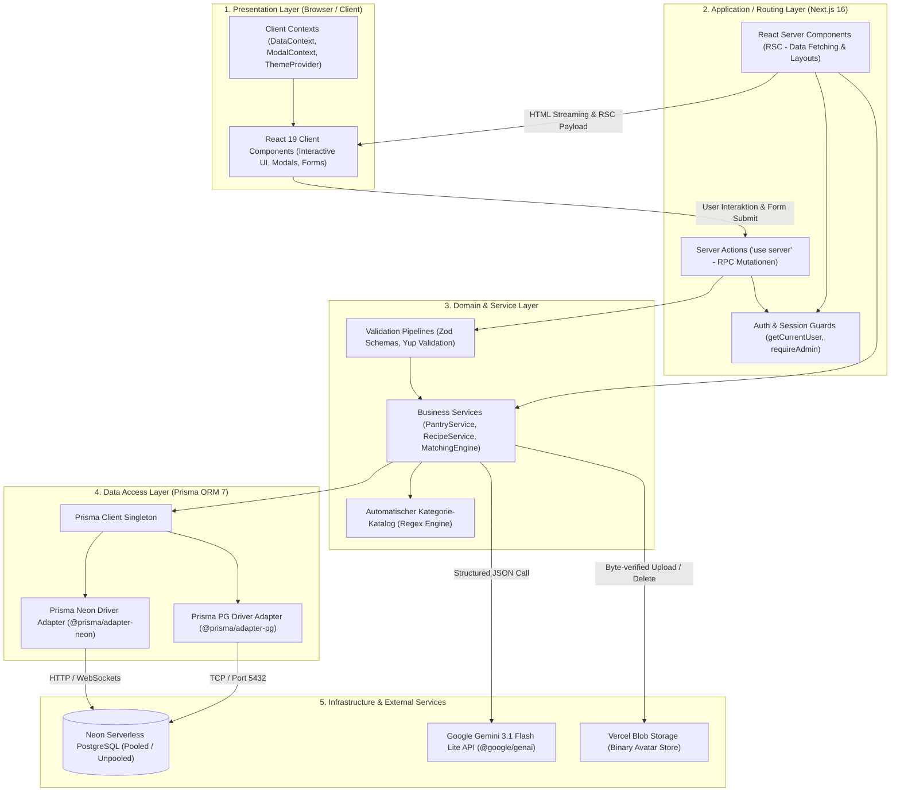
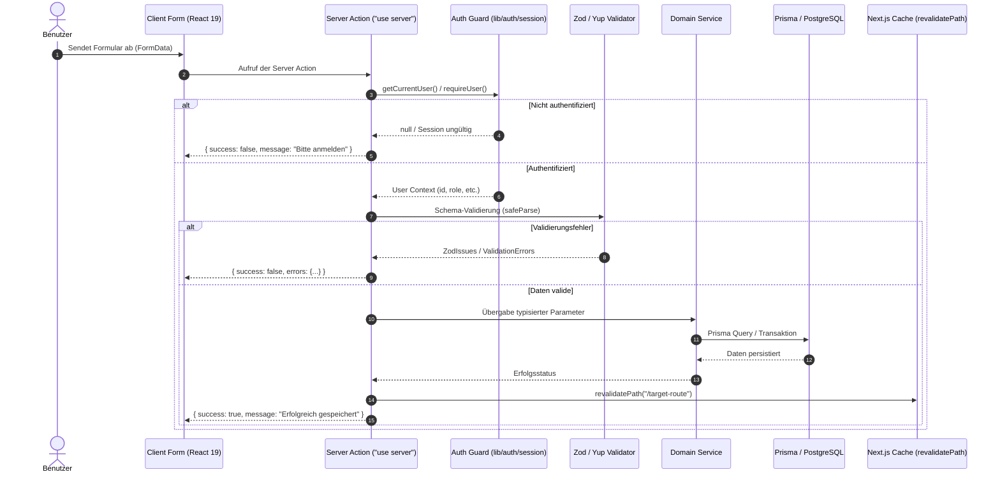
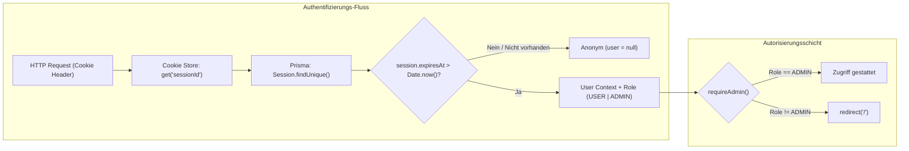
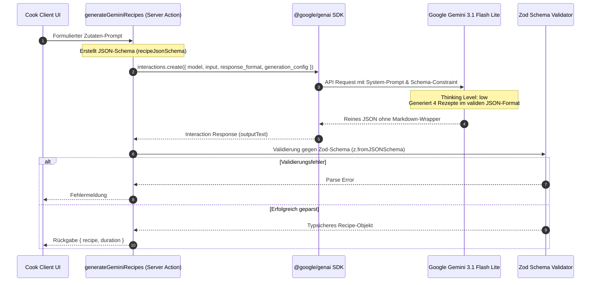
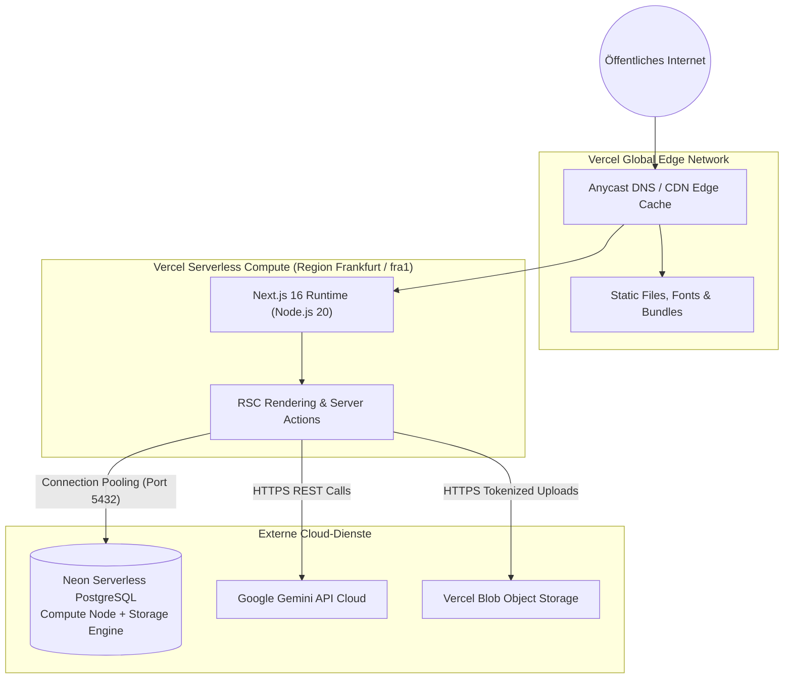

# 🏛️ Systemarchitektur – Smart Recipe & Meal Planner

> **Dokumentationsstatus:** Produktiv / Release 0.1.0  
> **Projekt:** `modul4-next-web-25-12-jp` (Smart Recipe & Meal Planner)  
> **Architektur-Typ:** Server-First Full-Stack Web Application (Next.js 16 App Router)

---

## 1. Architekturziele & Leitprinzipien

Die Systemarchitektur des **Smart Recipe & Meal Planners** wurde nach modernen Best Practices für skalierbare, typsichere und performante Webanwendungen konzipiert:

1. **Server-First & Zero-Bundle Overhead:** Maximale Verlagerung von Geschäftslogik und Datenabfragen auf den Server mittels React Server Components (RSC) und Server Actions. Der Client lädt nur minimalen JavaScript-Code für interaktive Elemente.
2. **End-to-End Typsicherheit:** Durchgängige Typisierung über alle Schichten hinweg – vom Datenbankschema (`schema.prisma`), über die generierten Prisma-Clients, Service-Funktionen und Server Actions bis hin zu den React-Komponenten.
3. **Domänengetriebene Modularität (Co-Location):** Gruppierung aller zu einem Feature gehörenden Komponenten, Server Actions, Datenbankabfragen und Typen in kohärenten Domänenordnern (`app/<domain>/_components/` und `app/<domain>/_lib/`).
4. **Resilienz & Datenintegrität:** Transaktionssicherheit bei komplexen Vorgängen (z.B. Delta-Berechnung der Einkaufsliste), Fremdschlüssel-Kaskaden in PostgreSQL und strikte Schema-Validierung (Zod / Yup).
5. **Autarke Sicherheit:** Eigene Session- und Rollenverwaltung mit State-of-the-Art Passworthash-Verfahren (Argon2) und geschützten HttpOnly-Cookies ohne Third-Party Vendor-Lock-in.
6. **Deterministische KI-Integration:** Anbindung moderner Sprachmodelle (Google Gemini) mit fest typisierten JSON-Schemas zur Vermeidung von Halluzinationen oder fehlerhaften Parsing-Zuständen.

---

## 2. Gesamtsystem & Schichtenmodell

Das System ist als klassisches, entkoppeltes **5-Schichten-Modell (5-Tier Layering)** aufgebaut:



---

## 3. Frontend- & Rendering-Architektur

Die Benutzeroberfläche nutzt die Rendering-Möglichkeiten von **Next.js 16 (App Router)** in Kombination mit **React 19**:

### 3.1 React Server Components (RSC) vs. Client Components

| Komponententyp | Direktive | Einsatzbereich im Projekt | Vorteile |
|---|---|---|---|
| **Server Component** | *(Standard)* | `app/**/page.tsx`, `layout.tsx`, `*Hero.tsx`, Datenabfragen | Direkter DB-Zugriff ohne REST-Endpunkte, kein Client-JS-Bundle, Secrets verbleiben sicher auf dem Server |
| **Client Component** | `"use client"` | Dialoge (`Modal.tsx`), Dropdowns, Suche/Filterung, Formulare | Lokaler React-State, Event-Listener (`onClick`, `onChange`), Headless UI Interaktionen, Animationen |

### 3.2 Co-Location Komponentenarchitektur
Jede Domäne ist autark gekapselt:
```text
app/recipes/
├── [id]/
│   ├── edit/
│   │   ├── _components/       # Spezifisch: Edit-Formular
│   │   └── page.tsx           # RSC: Lädt Rezeptdaten zum Bearbeiten
│   ├── loading.tsx            # Granularer Lade-Skeleton
│   └── page.tsx               # RSC: Rezept-Detailansicht
├── _components/               # Komponenten: Filter, Artikelkarte, Suchbox
├── _lib/                      # Server Actions, Prisma Queries, Zod-Typen
├── loading.tsx                # Lade-Skeleton für Rezeptübersicht
├── error.tsx                  # Error Boundary für Rezept-Subtree
└── page.tsx                   # RSC: Rezeptübersichtsseite mit SSR-Filtern
```

---

## 4. Server Actions & Mutation-Layer (RPC-Muster)

Statt traditioneller REST- oder GraphQL-Endpunkte setzt das System auf **Next.js Server Actions** (`"use server"`). Diese fungieren als Type-Safe Remote Procedure Calls (RPC):



### Typisierte Formularzustände
Alle Mutationen liefern standardisierte Antwortobjekte zurück, die nahtlos von Client-Formularen verarbeitet werden:
```typescript
export type ActionFormState<T = Record<string, string[]>> = {
  success?: boolean;
  message?: string;
  errors?: T;
};
```

---

## 5. Datenbank- & Persistenzarchitektur

### 5.1 Dual-Adapter Singleton (`lib/prisma.ts`)
Prisma 7 erfordert die Verwendung von SQL-Driver-Adaptern. Die Anwendung entscheidet zur Laufzeit über das Singleton-Pattern, welcher Adapter initiiert wird:
```typescript
function createPrismaClient() {
  const connectionString = process.env.DATABASE_URL;
  if (!connectionString) throw new Error("DATABASE_URL is not set");

  // In Vercel Edge/Serverless: HTTP-basierter Neon Adapter
  if (process.env.VERCEL) {
    const adapter = new PrismaNeon({ connectionString });
    return new PrismaClient({ adapter });
  }

  // Lokal / Docker / Node-Server: Standard TCP PG-Adapter
  const adapter = new PrismaPg({ connectionString });
  return new PrismaClient({ adapter });
}
```

### 5.2 Connection Pooling vs. Direct Connection
Neon bietet integriertes Connection-Pooling über PgBouncer:
- **`DATABASE_URL` (Pooled):** Verwendet Port 5432 mit Pooling-Endpunkt (`-pooler.region.aws.neon.tech`). Wird von der laufenden Anwendung genutzt, um Verbindungsengpässe bei parallelen Serverless-Instanzen zu vermeiden.
- **`DATABASE_URL_UNPOOLED` (Direct):** Direkte TCP-Verbindung zur PostgreSQL-Instanz. Wird in `prisma.config.ts` für Schema-Migrationen (`prisma migrate dev / deploy`) und Seeding verwendet, da DDL-Befehle (Data Definition Language) nicht über Transaction-Pooler laufen können.

### 5.3 Transaktionssicherheit & Integrität
Komplexe Logiken laufen atomar innerhalb von `prisma.$transaction`.  
*Beispiel: Einkaufslistengenerierung (`app/shopping-list/_lib/actions.ts`)*:
- Abfrage bestehender offener Einkaufsartikel
- Deduplizierung vorhandener Einträge
- Erstellung neuer Artikel (`createMany`)
- Aktualisierung bestehender Fehlmengen (`update`)
- Bereinigung redundanter Zeilen (`deleteMany`)
Alles geschieht in einer einzigen atomaren Transaktion, um Race Conditions zu verhindern.

---

## 6. Sicherheits- & Authentifizierungsarchitektur



### 6.1 State of the Art Passwortsicherheit
- **Argon2id:** Zum Hashing wird Argon2 mit konfigurierbarem Pepper-Secret (`ARGON2_SECRET`) verwendet. Argon2 schützt wirksam gegen GPU- und ASIC-basierte Brute-Force-Angriffe.
- **Session-Handling:** Bei Login wird ein kryptografischer CUID-Token generiert, in der `Session`-Tabelle persistiert und als `HttpOnly`, `SameSite=Lax`, `Secure` Cookie im Browser abgelegt.

### 6.2 Upload-Sicherheit & Magic-Bytes-Prüfung
Um das Hochladen von Schadcode (z.B. PHP/Executable getarnt als Bilddatei) zu verhindern, verlässt sich die Anwendung nicht auf die Dateiendung oder den vom Browser gesendeten `Content-Type`. Stattdessen werden die **ersten 12 Bytes (Magic Bytes)** der Binärdatei direkt analysiert:
```typescript
// Auszug aus app/user/_lib/actions.ts
async function detectImageType(file: File) {
  const bytes = new Uint8Array(await file.slice(0, 12).arrayBuffer());
  // JPEG: FF D8 FF
  if (bytes[0] === 0xff && bytes[1] === 0xd8 && bytes[2] === 0xff) return "image/jpeg";
  // PNG: 89 50 4E 47 0D 0A 1A 0A
  if (bytes[0] === 0x89 && bytes[1] === 0x50 && bytes[2] === 0x4e) return "image/png";
  // WebP: RIFF....WEBP
  if (String.fromCharCode(...bytes.slice(0, 4)) === "RIFF" &&
      String.fromCharCode(...bytes.slice(8, 12)) === "WEBP") return "image/webp";
  return null;
}
```
Erst nach erfolgreicher Typprüfung wird das Bild in den Vercel Blob Store geladen.

---

## 7. KI-Integrationsarchitektur (Google Gemini API)

Die KI-Funktion "Koch dir was" nutzt das offizielle Google GenAI SDK (`@google/genai`) mit dem Modell `gemini-3.1-flash-lite`:



### Deterministisches Schema-Design
Durch die Angabe von `response_format.schema` garantiert das Modell eine Antwort, die exakt der Spezifikation für Zutaten, Einheiten, Portionsgrößen und Zubereitungsschritte entspricht. Markdown-Fences wie ` ```json ` werden vom Modell serverseitig unterdrückt.

---

## 8. State-Management & UI-Kommunikation

Die Anwendung minimiert Client-State zugunsten von Server-State:
- **`DataContext`:** Puffert flüchtige Suchzustände der Zutatensuche ("Koch dir was"), damit beim Tab- oder Routenwechsel bereits gefundene oder generierte Rezepte erhalten bleiben.
- **`ModalContext`:** Verwaltet global einheitliche Dialoge und Toast-Nachrichten über React Portals.
- **`next-themes`:** Hält das aktive Theme (`light` / `dark`) und synchronisiert es mit dem HTML-Root-Element (`class="dark"`), um FOUC (Flash of Unstyled Content) zu verhindern.

---

## 9. Infrastruktur-, Netzwerk- & Deployment-Topologie



---

## 10. Resilienz & Fehlertoleranz

1. **Error Boundaries (`error.tsx`):**
   - Sowohl auf Root-Ebene (`app/error.tsx`) als auch domänenspezifisch (z.B. `app/recipes/error.tsx`) fangen Error Boundaries unerwartete Fehler isoliert ab, ohne die gesamte Applikation zum Absturz zu bringen.
2. **Streaming & Granulare Suspense-Grenzen (`loading.tsx`):**
   - Jede Hauptroute verfügt über eine eigene `loading.tsx`-Komponente mit Skeleton-Platzhaltern. Dadurch rendert die Shell sofort, während asynchrone DB-Abfragen gestreamt werden.
3. **Graceful Fallbacks bei externen Diensten:**
   - Ist der `GEMINI_API_KEY` nicht konfiguriert oder überlastet, fängt die Server Action den Fehler ab und liefert eine benutzerfreundliche Fehlermeldung, während die Kernanwendung (Rezeptdatenbank und Vorrat) voll funktionstüchtig bleibt.
