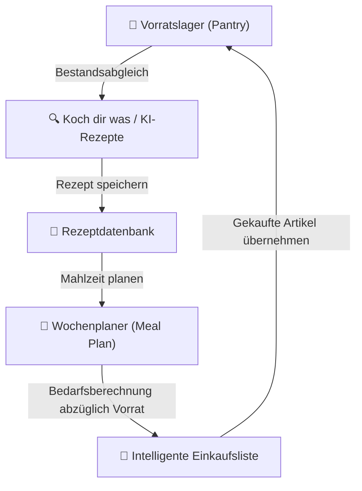
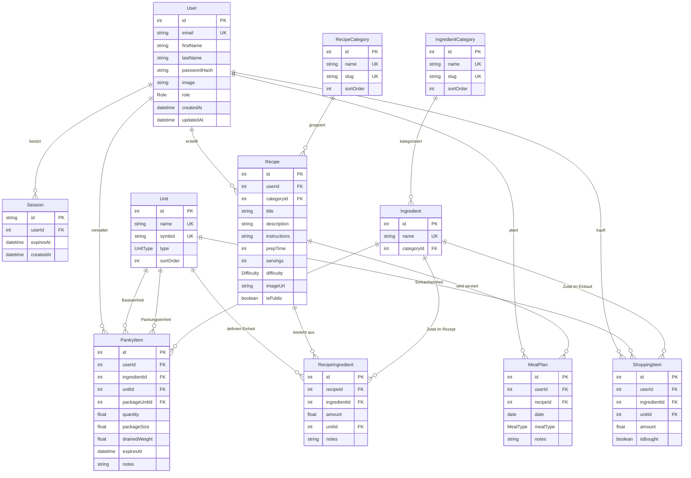
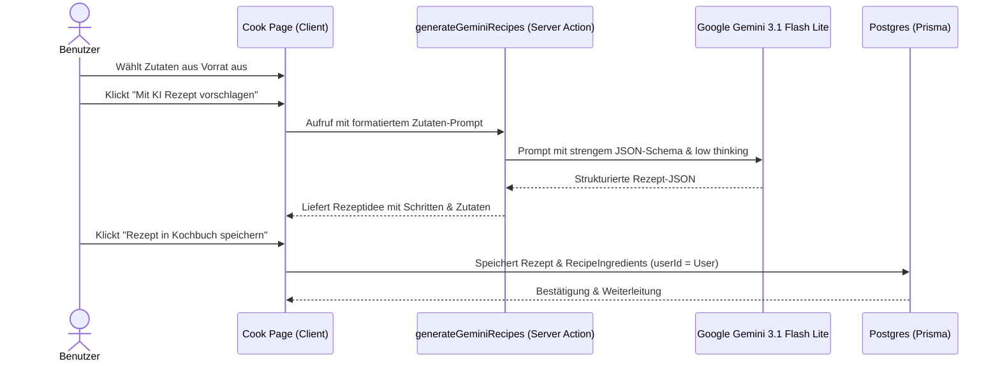
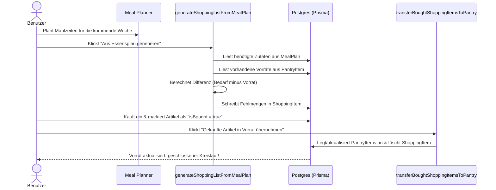

# 🍽️ Smart Recipe & Meal Planner – Projektübersicht

> **Weniger Lebensmittel verschwenden. Mehr aus vorhandenen Zutaten machen.**  
> Eine moderne Full-Stack-Webanwendung zur nachhaltigen Vorratshaltung, Rezeptfindung, KI-gestützten Rezeptgenerierung, Mahlzeitenplanung und automatisierten Einkaufslistenerstellung.

---

## 📌 Schnellübersicht

| Eigenschaft | Details |
|---|---|
| **Projektname** | `modul4-next-web-25-12-jp` / Smart Recipe & Meal Planner |
| **Live-Demo** | [https://nextjs-vercel-neon-m4.vercel.app](https://nextjs-vercel-neon-m4.vercel.app) |
| **GitHub-Repository** | [https://github.com/jeypack/nextjs-vercel-neon-m4](https://github.com/jeypack/nextjs-vercel-neon-m4) |
| **Framework & UI** | Next.js 16 (App Router) • React 19 • TypeScript • Tailwind CSS v4 |
| **Datenbank & ORM** | PostgreSQL (Neon Serverless) • Prisma ORM 7 (mit Driver Adaptern) |
| **KI-Integration** | Google Gemini API (`gemini-3.1-flash-lite` via `@google/genai`) |
| **Storage & Hosting** | Vercel Platform • Vercel Blob (Asset Storage) |
| **Authentifizierung** | Eigene Session-Authentifizierung mit Argon2 & HttpOnly-Cookies |

---

## 🎯 Vision & Problemstellung

Im Alltag landen erhebliche Mengen genießbarer Lebensmittel im Müll – oft schlicht aus mangelnder Übersicht über vorhandene Vorräte, fehlender Inspiration für die Resteverwertung oder ineffizienter Einkaufsplanung.

**Smart Recipe & Meal Planner** schließt diesen Kreislauf ("Closed-Loop-Prinzip"):
1. **Erfassen:** Vorhandene Vorräte werden übersichtlich nach Kategorien, Mengen und Ablaufdaten gepflegt.
2. **Kombinieren:** "Koch dir was" analysiert den Vorrat und schlägt Rezepte vor, die primär vorhandene Zutaten verwerten.
3. **Inspirieren (KI):** Wenn klassische Rezepte nicht passen, generiert Google Gemini aus vorhandenen Resten maßgeschneiderte Rezeptvorschläge mit vollständigen Zubereitungsschritten.
4. **Planen:** Mahlzeiten für die Woche werden für Frühstück, Mittag und Abendessen zugewiesen.
5. **Einkaufen:** Die Einkaufsliste ermittelt automatisch das Delta: *Was wird für geplante Mahlzeiten benötigt, abzüglich dessen, was bereits im Vorrat ist?*
6. **Rückführen:** Gekaufte Artikel lassen sich mit einem Klick direkt in den Vorrat buchen.



---

## 🛠️ Technologie-Stack

| Schicht / Bereich | Technologie | Beschreibung & Zweck |
|---|---|---|
| **Frontend Framework** | **Next.js 16.3** | App Router, React Server Components (RSC), Server Actions |
| **UI-Bibliothek** | **React 19.2** | Komponentenbasiertes UI mit Concurrent Features |
| **Programmiersprache** | **TypeScript 5** | Durchgehende Typsicherheit von der DB bis zur Benutzeroberfläche |
| **Styling & Design** | **Tailwind CSS v4** | Modernes Atomic-CSS mit CSS-Variables und responsiven Breakpoints |
| **Theme Management** | **next-themes** | Nahtloser Wechsel zwischen Light- und Dark-Mode |
| **UI-Komponenten** | **Headless UI & Lucide** | Barrierefreie Dialoge/Comboboxen & einheitliche Vektor-Icons |
| **Datenbank** | **PostgreSQL (Neon)** | Serverless Relationale Datenbank mit Branching und Pooling |
| **ORM** | **Prisma 7.9** | Generierter Client mit `@prisma/adapter-neon` & `@prisma/adapter-pg` |
| **Authentifizierung** | **Argon2 + Custom Sessions** | Serverseitig signierte Passwörter, Sitzungen in Postgres |
| **Formulare & Validierung** | **Zod 4 & Yup 1** | Strikte Validierung auf Client- und Server-Ebene (Server Actions) |
| **Künstliche Intelligenz** | **Google Gemini API** | SDK `@google/genai` (Modell `gemini-3.1-flash-lite`, Structured JSON) |
| **Objektspeicher** | **Vercel Blob** | Cloud-Storage für Benutzer-Avatare mit Byte-Level Mime-Prüfung |
| **Deployment** | **Vercel** | Edge-optimiertes Hosting, Environment-Management und CI/CD |

---

## 🏛️ System- & Anwendungsarchitektur

Die Anwendung folgt konsequent dem **Server-First-Paradigma** des Next.js App Routers:

### 1. Server Components & Server Actions
- **Server Components (RSC):** Alle Seiten (`page.tsx`) und Lade-Layouts sind standardmäßig Server Components. Daten werden direkt in der Komponente über Prisma geladen – ohne Client-Ladeflackern oder unnötige Client-Bundles.
- **Server Actions (`"use server"`):** Mutationen (Erstellen, Aktualisieren, Löschen) erfolgen über Server Actions. Dadurch entfällt ein klassischer REST-Controller-Overhead. Pfade werden nach Mutationen über `revalidatePath()` unmittelbar invalidiert.

### 2. Feature-basierte Modularisierung (Co-Location)
Statt monolithischer Ordner wie `/components` oder `/actions` ist das Projekt strikt domänengetrieben aufgebaut:
- Jede Hauptdomäne (`cook`, `meal-plan`, `pantry`, `recipes`, `shopping-list`, `user`) besitzt:
  - `page.tsx`: Routen-Einstiegspunkt (Server Component)
  - `_components/`: Spezifische Client- und Server-Komponenten der Domäne
  - `_lib/`: Domänenspezifische Server Actions, Abfragen (`queries.ts`), Hilfsfunktionen (`service.ts`) und Zod-Typen (`types.ts`)

### 3. Duales Prisma-Treiberadapter-Pattern
In `lib/prisma.ts` implementiert ein Singleton-Pattern die dynamische Adapter-Wahl:
- In der Vercel-Cloud-Umgebung (`process.env.VERCEL`): Nutzung von `@prisma/adapter-neon` für latenzarme, HTTP-basierte Serverless-Verbindungen.
- In lokaler Entwicklung / Docker: Direkter PostgreSQL-Adapter `@prisma/adapter-pg` für maximale lokale Performance.

### 4. Custom Session-Authentifizierung
- Eigenständiges Auth-System ohne Drittanbieter-Lock-in.
- Passwörter werden mit **Argon2** gehasht.
- Eine `Session`-Tabelle in Postgres verwaltet Session-Tokens; der Token wird als `HttpOnly`, `SameSite=Lax` Cookie gespeichert.
- Rollenbasiertes Rechtesystem (`Role: USER | ADMIN`).

---

## 🗄️ Datenmodell & Entity-Relationship (ERD)

Das relationale Datenmodell in Prisma ist normalisiert und garantiert referenzielle Integrität über Fremdschlüssel und Kaskadierregeln:



### Enums
- **Role:** `USER`, `ADMIN`
- **MealType:** `BREAKFAST`, `LUNCH`, `DINNER`
- **Difficulty:** `EASY`, `MEDIUM`, `HARD`
- **UnitType:** `WEIGHT` (g, kg), `VOLUME` (ml, l), `COUNT` (Stück, Bund), `OTHER` (EL, TL, Prise)

---

## 🔍 Funktionsmodule im Deep Dive

### 1. Vorratsverwaltung (`/pantry`)
- **Artikelverwaltung:** Hinzufügen, Bearbeiten, Löschen und Filtern vorhandener Lebensmittel.
- **Intelligente Autokategorisierung:** Beim Eintippen einer neuen Zutat analysiert ein Regex-Katalog (`app/pantry/_lib/category.ts`) die Bezeichnung und ordnet sie vollautomatisch Kategorien wie *Gemüse*, *Milchprodukte*, *Gewürze* oder *Hülsenfrüchte* zu.
- **Erweitertes Einheitensystem:** Unterstützt Basiseinheiten sowie Packungsgrößen (z.B. "2 Dosen à 400 g").
- **Haltbarkeitskontrolle:** Visuelle Warnung bei ablaufenden oder abgelaufenen Artikeln (`expiresAt`).

### 2. Rezeptverwaltung (`/recipes`)
- **Rezeptkatalog:** Durchstöbern öffentlicher Community-Rezepte oder Verwalten privater Familienrezepte.
- **Detaillierte Metadaten:** Zubereitungszeit, Portionen, Schwierigkeitsgrad, strukturierte Zutatenliste mit Notizen (z.B. "fein gewürfelt").
- **Kategoriensuche & Volltextsuche:** Schnelles Auffinden über Filter-Comboboxen.
- **Rezept-Editor:** Volle CRUD-Möglichkeiten mit serverseitiger Validierung für eigene Kreationen.

### 3. Koch dir was & KI-Chef (`/cook`)
- **Bestandsabgleich (Matching Engine):** Vergleicht die Zutaten des eigenen Vorrats mit allen Rezepten der Datenbank. Berechnet die Trefferquote und hebt fehlende Zutaten farblich hervor.
- **KI-Rezeptgenerierung mit Google Gemini:**
  - Anbindung an das Modell `gemini-3.1-flash-lite`.
  - Strikte Übergabe eines `z.JSONType`-Schemas für strukturierte JSON-Rückgaben (Titel, Beschreibung, Vorbereitungszeit, Portionen, Zutatenliste mit Einheiten und Zubereitungsschritten).
  - One-Click-Speichern: Das generierte Rezept kann mit einem Klick dauerhaft als eigenes Rezept in die Datenbank übernommen werden.

### 4. Wochenplaner / Meal Planner (`/meal-plan`)
- **Kalender-Matrix:** Visuelle Wochenübersicht für Frühstück, Mittagessen und Abendessen.
- **Konfliktvermeidung:** Eindeutiger Constraint (`@@unique([userId, date, mealType])`) verhindert Doppelbelegungen desselben Zeitfensters.
- **Schnellzuweisung:** Rezepte können direkt aus der Rezeptansicht oder per Dialog im Kalender eingeplant werden.

### 5. Intelligente Einkaufsliste (`/shopping-list`)
- **Automatische Bedarfsberechnung:** 
  - Liest alle zukünftig geplanten Mahlzeiten ab dem aktuellen Zeitpunkt aus.
  - Berücksichtigt für den aktuellen Tag die verbleibenden Mahlzeiten (z.B. ab 18 Uhr nur noch Abendessen).
  - Summiert alle benötigten Zutaten.
  - Subtrahiert vorhandene Bestände aus dem Vorrat (`PantryItem`).
  - Generiert präzise Einkaufsartikel für den Fehlbestand.
- **Closed-Loop-Rückführung (`transferBoughtShoppingItemsToPantry`):**
  - Gekaufte Artikel können abgehakt werden.
  - Ein Klick überträgt gekaufte Lebensmittel direkt in den Vorrat und bereinigt die Einkaufsliste.

### 6. Benutzer- & Rechteverwaltung (`/user`, `/user/profile`, `lib/auth`)
- **Sitzungsverwaltung:** Sichere Registrierung, Login und Logout.
- **Profilpflege:** Ändern von Namen, Passwörtern und Profilbild.
- **Avatar-Upload via Vercel Blob:**
  - Binäre Validierung der Datei über sogenannte Magic Bytes (Header-Byte-Signatur für JPEG, PNG und WebP), um manipulierte Dateiendungen abzuwehren.
  - Automatisches Löschen alter Avatare aus dem Blob Store beim Austausch.
- **Administrationsbereich:** Administratoren können Nutzerkonten einsehen, Benutzer löschen und Benutzerrollen (`USER` / `ADMIN`) verwalten.

---

## 🔄 Kernabläufe (Workflows)

### Ablauf 1: KI-Rezeptgenerierung & -Übernahme


### Ablauf 2: Automatischer Einkaufs- und Vorratskreislauf


---

## 📁 Projekt- & Ordnerstruktur

```text
├── app/                           # Next.js App Router (RSC & Server Actions)
│   ├── _components/               # Globale UI-Komponenten (Header, Footer, Toast, Modal, etc.)
│   ├── _context/                  # React Contexts (DataContext, ModalContext)
│   ├── _lib/                      # Globale Hilfsfunktionen (Einheiten, Tailwind-Styles, Navigation)
│   ├── api/                       # API-Routen (z.B. Gemini Health-Check)
│   ├── cook/                      # Feature: Zutatensuche & KI-Chef
│   │   ├── _components/           # AIRecipe, RecipeCard, IngredientChips, etc.
│   │   ├── _lib/                  # Gemini AI Actions, Matching Queries & Typen
│   │   └── page.tsx               # Server Page: "Koch dir was"
│   ├── meal-plan/                 # Feature: Wochenplaner
│   │   ├── _components/           # MealCalendarRange, MealPlanSlotCard, Dialoge
│   │   ├── _lib/                  # Actions, Slot-Queries, Date-Utils & Typen
│   │   └── page.tsx               # Server Page: Wochenplan
│   ├── pantry/                    # Feature: Vorratskammer
│   │   ├── _components/           # PantryList, PantryCreateForm, DeleteDialog
│   │   ├── _lib/                  # Actions, Category-Katalog, Pantry-Service
│   │   └── page.tsx               # Server Page: Vorrat
│   ├── recipes/                   # Feature: Rezeptbuch
│   │   ├── [id]/                  # Rezept-Detailansicht & Bearbeitung (/edit)
│   │   ├── new/                   # Rezept-Neuerstellung
│   │   ├── _components/           # RecipeArticle, FiltersForm, SearchCombobox
│   │   ├── _lib/                  # Recipe Service, Queries, Validation
│   │   └── page.tsx               # Server Page: Rezeptübersicht
│   ├── shopping-list/             # Feature: Einkaufsliste
│   │   ├── _components/           # ShoppingListItems, GeneratorForm, Dialoge
│   │   ├── _lib/                  # Actions (Delta-Kalkulation, Vorratstransfer)
│   │   └── page.tsx               # Server Page: Einkaufsliste
│   ├── user/                      # Feature: Benutzerkonten & Administration
│   │   ├── profile/               # Benutzerprofil & Avatar-Verwaltung
│   │   ├── _components/           # AuthTabs, LoginForm, RegisterForm, UserList
│   │   ├── _lib/                  # Auth Actions & Typen
│   │   └── page.tsx               # Server Page: Authentifizierung & Admin
│   ├── globals.css                # Globale Styles & Tailwind v4 Direktiven
│   ├── layout.tsx                 # Root Layout mit ThemeProvider & Navigation
│   └── page.tsx                   # Startseite / Dashboard (Gast & Personalisiert)
├── docs/                          # Projektdokumentation & Screenshots
│   ├── images/                    # UI-Screenshots (home, cook, pantry, meal-plan, etc.)
│   ├── project-overview.md        # Diese umfassende Projektübersicht
│   └── README.md                  # Kompakte Kurzdokumentation
├── lib/                           # Wiederverwendbare Backend-Infrastruktur
│   ├── auth/                      # Session-Handling, Argon2-Hashing, Guards
│   ├── generated/prisma/          # Generierter Prisma 7 Client
│   └── prisma.ts                  # Prisma Client Singleton mit Neon/PG-Adapter
├── prisma/                        # Datenbank-Konfiguration & Migrationen
│   ├── migrations/                # Versionierte SQL-Migrationen
│   ├── schema.prisma              # Datenbankschema & Modelldefinitionen
│   ├── seed-meal-planner-units.ts # Vollständiger Seed (Einheiten, Rezepte, Zutaten)
│   ├── seed-meal-planner.ts       # Basis-Seed für den Mahlzeitenplaner
│   └── seed.ts                    # Initialer Seed (Admin & Benutzer)
├── public/                        # Statische Assets (Icons, Platzhalterbilder)
├── docker-compose.yml             # Lokale PostgreSQL 15 Datenbank
├── next.config.ts                 # Next.js Konfiguration
└── package.json                   # Abhängigkeiten & Scripts
```

---

## ⚡ npm-Skripte & Werkzeuge

| Skript | Befehl | Zweck |
|---|---|---|
| `npm run dev` | `next dev` | Startet den Next.js Entwicklungsserver |
| `npm run build` | `prisma generate && next build` | Erstellt den optimierten Produktions-Build |
| `npm run start` | `next start` | Startet den Produktionsserver |
| `npm run lint` | `eslint` | Führt ESLint-Codeanalyse durch |
| `npm run generate` | `prisma generate` | Generiert den Prisma-Client neu |
| `npm run dev:migrate` | `prisma migrate dev && prisma generate` | Führt Schema-Migrationen lokal aus |
| `npm run dev:studio` | `prisma studio` | Startet die visuelle Prisma Studio Weboberfläche |
| `npm run seed:meal-planner:prod`| `dotenv -e .env.neon -- tsx prisma/seed-meal-planner-units.ts` | Befüllt die Neon-Produktionsdatenbank mit Demodaten |
| `npm run format:schema` | `prisma format` | Formatiert die `schema.prisma`-Datei |
| `npm run validate:schema` | `prisma validate` | Prüft die Gültigkeit des Prisma-Schemas |

---

## 🔐 Umgebungsvariablen

Zur Ausführung der Anwendung werden folgende Variablen in der `.env`-Datei benötigt:

```env
# Primäre Datenbankverbindung (Pooling)
DATABASE_URL="postgresql://[user]:[password]@[host]-pooler.[region].aws.neon.tech/[db]?sslmode=require"

# Direkte Datenbankverbindung für Migrationen (Unpooled)
DATABASE_URL_UNPOOLED="postgresql://[user]:[password]@[host].[region].aws.neon.tech/[db]?sslmode=require"

# Vercel Blob Storage (Profilbilder)
BLOB_STORE_ID="store_id"
BLOB_READ_WRITE_TOKEN="vercel_blob_rw_token"

# Google Gemini API (KI-Rezeptsuche)
GEMINI_API_KEY="AIzaSy..."

# Eigene Authentifizierung & Hashing
ARGON2_SECRET="extra-strong-pepper-secret"
ADMIN_EMAIL="admin@mail.com"
ADMIN_PASSWORD="super-secure-password"
```

---

## 🚀 Fazit

**Smart Recipe & Meal Planner** beweist eindrucksvoll das Zusammenspiel modernster Webtechnologien im Jahr 2026:
- **Performance & Usability:** Schnelle Ladezeiten durch Next.js Server Components, nahtlose Benutzererlebnisse ohne störende Reloads.
- **Praxisrelevanter Nutzen:** Durchdachter "Closed-Loop"-Ansatz von der Vorratshaltung über die Planung bis zur Verwertung von Resten.
- **Smarte Erweiterungen:** Sinnvolle KI-Integration mit Google Gemini statt bloßer Gimmicks.
- **Robuste Architektur:** Saubere Trennung von Domänen, strikte Typisierung und wartungsfreundliches Code-Design.
